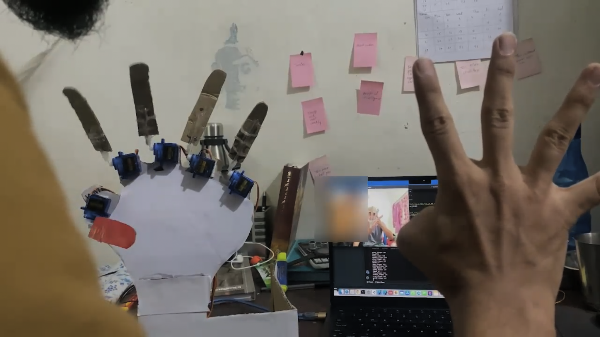
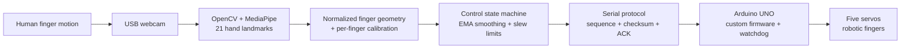

<div align="center">

# Low-Cost, Real-Time Human Hand Motion Replication Using Computer Vision

**A webcam-to-actuator robotic hand prototype using camera-based hand tracking, calibrated motion mapping, and an Arduino UNO.**

[](https://github.com/phoenix1revv-risefromashes/vision-guided-robotic-hand-teleoperation/actions/workflows/ci.yml)


[**Watch prototype demonstration**](media/robotic_hand_demo.mp4) · [**View circuit schematic**](hardware/reference/original_circuit_schematic.png) · [**Read system design**](docs/system_design.md) · [**Hardware setup**](docs/hardware_setup.md)



*Photograph of the original physical prototype. The demonstration video documents the original implementation, not hardware validation of the refactored controller.*

</div>

## Overview

Human hand gestures are tracked through an ordinary webcam and translated into movement commands for five servo-driven robotic fingers. The project demonstrates **end-to-end perception-to-actuation integration** using accessible hardware, with more demanding vision processing performed on a host computer and lightweight servo control handled by an **Arduino UNO**.

The goal is a reproducible, cost-conscious platform for experimenting with human-to-robot motion mirroring—not a claim of a novel teleoperation architecture or a production-ready manipulator. **Low-cost** describes the use of commodity components; a verified bill of materials or cost comparison has not yet been published.

## System architecture



**Compute partitioning:** the laptop processes camera frames and landmarks; the UNO receives five bounded angle setpoints and generates the motor-control signals. This is **open-loop finger-motion replication**, not joint-position feedback or autonomous grasping.

### Engineering features

- **Vision:** MediaPipe Tasks hand landmarks, palm-normalized finger-extension measurements, and configurable per-finger motion mapping.
- **Control:** manual arming, tracking-loss handling, exponential smoothing, rate limiting, per-command slew limits, deadband, and endpoint clamps.
- **Communication:** 115200-baud USB serial protocol with command sequences, XOR checksums, acknowledgments, and error handling.
- **Firmware:** Arduino UNO servo controller with a 450 ms communication watchdog, command bounds, and a normally-closed logic interlock input.
- **Testability:** simulated actuator backend, isolated Python modules, automated unit tests, and CI definitions for Python and Arduino compilation.

## Technology stack

| Layer | Technology | Responsibility |
| --- | --- | --- |
| Vision | Python, OpenCV, MediaPipe | Camera input and 21-point hand tracking |
| Geometry / mapping | Python | Hand-relative feature extraction and servo calibration |
| Motion control | Python | Arming state, filtering, command-rate and angle limits |
| Communication | pyserial, USB serial | Checksummed host-to-controller commands |
| Embedded controller | **Arduino UNO (ATmega328P)**, Arduino Servo library | Servo PWM generation, bounds, interlock, watchdog |
| Actuators | Five hobby servos | Physical finger movement |
| Quality tooling | pytest, Ruff, MyPy, GitHub Actions | Unit testing, linting, type checking, CI |

## Demonstration and hardware

| Original prototype | Electrical reference | System diagram |
| --- | --- | --- |
| [Photo](media/physical_prototype.png) | [Wiring schematic](hardware/reference/original_circuit_schematic.png) | [Original design](hardware/reference/original_system_diagram.png) |

**[View the original robotic-hand demonstration video (MP4)](media/robotic_hand_demo.mp4)**

The original project used Python, OpenCV, MediaPipe, **PyFirmata**, and Arduino UNO. The **refactored** implementation uses a different, custom serial protocol and therefore requires the bundled Arduino firmware. Original source files remain available under [`archive/original/`](archive/original/).

## Getting started

**Supported Python:** 3.11, 3.12, 3.13 for the base package. The optional vision dependencies additionally require an available compatible MediaPipe wheel and a webcam-capable desktop environment.

### 1. Run software tests and a hardware-free simulation

```bash
python3 -m venv .venv
source .venv/bin/activate  # Windows: .venv\Scripts\activate
python -m pip install -e '.[dev]'
python -m pytest -q
python -m robotic_hand --mode demo
```

The demo uses synthetic hand landmarks and a simulated actuator: **no camera, Arduino, or motor movement** is involved.

### 2. Preview webcam tracking (motor output disabled)

```bash
python -m pip install -e '.[vision]'
python scripts/download_model.py
python -m robotic_hand --mode camera
```

Camera controls: `a` = arm after stable tracking, `s` = disarm, `q` = quit. Without explicit hardware flags, camera mode uses the **simulated** actuator.

### 3. Connect the Arduino hardware (bench validation only)

The hardware path requires the custom firmware, a compatible external servo supply, a normally-closed logic interlock on **D2**, a shared signal ground, and a **separate physical servo-power cutoff**. The historical wiring diagram is reference material, not a certified design.

```bash
# Install the Arduino AVR core and compile the custom UNO sketch
arduino-cli core update-index
arduino-cli core install arduino:avr
arduino-cli compile --fqbn arduino:avr:uno hardware/firmware/robotic_hand_controller

# Upload to the Arduino UNO (adjust the serial port)
arduino-cli upload -p /dev/ttyACM0 --fqbn arduino:avr:uno hardware/firmware/robotic_hand_controller

# Host-side dependencies and camera-to-hardware controller
python -m pip install -e '.[vision,hardware]'
python -m robotic_hand --mode camera --enable-hardware --port /dev/ttyACM0
```

The **`--enable-hardware` and `--port` flags are both required** to transmit physical commands. Configuration values in [`config/hand_config.json`](config/hand_config.json) are illustrative—not calibrated limits for the pictured prototype.

Further details: [hardware setup](docs/hardware_setup.md) · [calibration](docs/calibration.md) · [control architecture](docs/system_design.md).

## Verification and CI

The repository includes GitHub Actions jobs for Python **3.11 / 3.12 / 3.13** and for **Arduino UNO firmware compilation**.

| Check | Coverage | Verification status |
| --- | --- | --- |
| Python unit tests | Config, geometry, control states, transport, protocol | **19 passed locally** |
| Simulation smoke test | Full control path without physical motors | **Passed locally** |
| Ruff / strict MyPy | Lint and static type checks | Configured in GitHub Actions; not verified in this environment |
| Firmware compilation | `arduino:avr:uno` target | Configured in GitHub Actions; not verified in this environment |
| GitHub Actions | Python matrix + Arduino firmware | **Pending first actual workflow run** |
| Physical hardware integration | Servo motion, wiring, firmware ↔ host serial | **Not yet verified for the refactor** |

The **CI badge at the top reflects the actual GitHub Actions workflow**, not a manually asserted green status. It will display a result after this repository is published at the linked GitHub path and the workflow runs successfully.

## Reported results (original prototype)

The original experiment reported these outcomes; **they have not been reproduced for the refactored software**:

| Reported measurement | Result | Qualification |
| --- | --- | --- |
| Average response delay | **0.58 s** | Original method and trial-level data unavailable |
| Human-to-robot angular deviation | **12°–20°** | Measurement procedure not independently verified |
| “Efficiency” | **Above 90%** | Metric was not defined; **not** presented as tracking accuracy |

See [validation notes](docs/validation.md) for repeatability, latency, and fault-injection test plans.

## Project layout

```text
├── .github/workflows/ci.yml          # Python matrix + UNO firmware compile
├── src/robotic_hand/                 # Tracking, geometry, control, transport, CLI
├── hardware/firmware/                # Arduino UNO custom firmware
├── hardware/reference/               # Original circuit and architecture images
├── config/hand_config.json           # Per-finger calibration and control settings
├── scripts/download_model.py         # External MediaPipe model downloader
├── tests/                             # Automated Python test suite
├── docs/                              # Design, hardware, calibration, validation
├── media/                             # Original physical prototype + demo video
├── archive/original/                  # Original source preserved unchanged
└── pyproject.toml                     # Python package and tooling configuration
```

## Engineering limitations and safety boundary

- The five servos are **open-loop**: actual finger angle, force, and contact are not measured.
- Camera occlusion, palm orientation, and mismatched calibration can degrade motion replication.
- A firmware watchdog or PWM detach **does not remove motor power**; it is not a physical emergency stop.
- The updated Python protocol and firmware have **not yet been validated together on the original device**.
- No claim is made of industrial safety, hazardous-environment readiness, or measured performance improvement over other systems.

This remains a **research and bench prototype**. Physical integration requires independent power isolation, verified electrical wiring, mechanical clearance, calibrated travel bounds, and staged testing.

## Documentation

- [System design and serial protocol](docs/system_design.md)
- [Arduino UNO wiring and firmware](docs/hardware_setup.md)
- [Finger calibration and controller parameters](docs/calibration.md)
- [Verification evidence and performance limitations](docs/validation.md)

## Author and license

**Phoenix Bogati** — original robotic hand prototype, demonstration, and project materials. The original implementation is preserved for provenance alongside the engineering refactor.

Repository code is provided under the [MIT License](LICENSE). Third-party dependencies and externally downloaded MediaPipe assets remain subject to their respective licenses.
